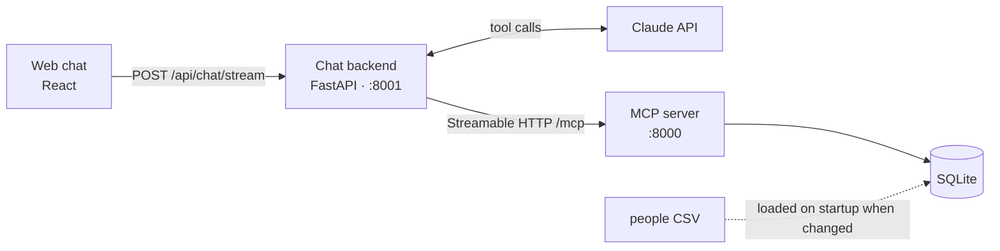

# People Search

Ask questions about a company's people records in plain English, for example *"How many people live in London?"* or *"What is the average age of employees?"*, and get answers backed by real data.

The project has two parts:

1. **An MCP server** that loads the people CSV into SQLite and exposes typed query tools over **Streamable HTTP at `/mcp`**.
2. **A chat interface**: a React web app plus a small Python backend. The backend lets Claude answer questions by calling the MCP server's tools.

**Design decisions** (why typed tools, how salaries and currencies work, error handling, speed and caching) are explained in [DESIGN.md](DESIGN.md).



## Quick start

You need an [Anthropic API key](https://platform.claude.com) (separate from a claude.ai subscription):

```bash
cp .env.example .env          # then put your key in ANTHROPIC_API_KEY
```

**With Docker (one command):**

```bash
docker compose up --build     # or: make up
```

Open **http://localhost:8080**.

**Without Docker:** needs [uv](https://docs.astral.sh/uv/) (it installs Python for you) and Node.js 20+.

```bash
make install                  # uv sync + npm ci
make dev                      # MCP server, chat backend and web UI together; Ctrl+C stops them
```

Open **http://localhost:5173**. Run `make help` to list every task.

While Claude works, you see each lookup as it happens ("🔧 Looking up `count_people`…"), then the answer appears as it's written. Under each answer, **"Tools used"** shows exactly which MCP tools Claude called, with what arguments, and what the server returned.

## Example questions

| Question | What happens |
|---|---|
| How many people live in London? | `count_people` filtered by city |
| What is the average age of employees? | `aggregate` of age over active people |
| How many hourly employees work in London? | `count_people` filtered by city and salary type |
| Average salary by office | `aggregate` grouped by office, in each office's own currency |
| Average salary of everyone in USD | `aggregate` with live conversion to USD |
| Who reports to Bea? | `get_person`, which matches the nickname and returns direct reports |
| And in New York? | Follow-up questions work because the chat history is sent with each request |

## MCP tools

| Tool | Purpose |
|---|---|
| `get_dataset_overview` | Total count, valid values for each category field (cities, teams, …), and notes on the data |
| `count_people` | Count people matching a filter, optionally grouped by a field |
| `aggregate` | avg / min / max / sum / median of age, tenure or annual salary |
| `search_people` | List matching people, sorted, limited to 100 per call |
| `get_person` | One person's full record with their manager and direct reports |

All tools share one typed `filter` object (city, team, salary type, age range, manager, …). A misspelled argument or field is an error, never silently ignored. See [DESIGN.md](DESIGN.md) for the details.

To explore the server on its own, run `npx @modelcontextprotocol/inspector` and connect to `http://localhost:8000/mcp` (transport: Streamable HTTP).

## Project layout

One **uv workspace**: a root `pyproject.toml` and one `uv.lock` for both Python packages.

```
pyproject.toml           workspace root: shared dev tools and their settings (ruff, mypy, pytest)
server/src/people_server/
    __main__.py          entry point: load the CSV if needed, start the server
    settings.py          PEOPLE_CSV, PEOPLE_DB, MCP_PORT, FX_ENABLED …
    ingest.py            CSV → SQLite (on demand, or `uv run people-ingest file.csv`)
    models.py            typed tool inputs and outputs
    server.py            create_server(): the five MCP tools
    fx.py                live exchange rates, only when asked
chat/src/people_chat/
    __main__.py          entry point: start the API
    settings.py          ANTHROPIC_API_KEY, CLAUDE_MODEL, CLAUDE_EFFORT, MCP_URL
    models.py            request, response and streamed-event models
    agent.py             the Claude tool-use loop over MCP
    app.py               create_app(): the HTTP endpoints and error handling
web/src/App.tsx          React chat UI
tests/                   unit/, integration/, e2e/ (see Tests)
docker/, docker-compose.yml, Makefile, .github/workflows/ci.yml
data/                    people-list-export.csv (the source data)
```

## Configuration

Both Python services read environment variables, or `.env` in the folder they run from. Settings are validated at startup: a wrong value stops the service with a clear message.

| Variable | Default | Purpose |
|---|---|---|
| `ANTHROPIC_API_KEY` | (none) | Required. Your Claude API key |
| `CLAUDE_MODEL` | `claude-haiku-5-5` | The Claude model to use |
| `CLAUDE_EFFORT` | `low` | How hard the model thinks: `low`, `medium`, `high`, `xhigh` or `max`. Lower is faster |
| `MCP_URL` | `http://localhost:8000/mcp` | Where the chat backend finds the MCP server |
| `PEOPLE_CSV` | `data/people-list-export.csv` | The CSV export the MCP server serves |
| `PEOPLE_DB` | `data/people.db` | Where its SQLite copy is built |
| `FX_ENABLED` | `true` | Allow live currency conversion (needs internet) |

## Data

The MCP server builds its SQLite database from the CSV **on startup, whenever the CSV is newer than the database**, so there's no manual step. To serve a different file, set `PEOPLE_CSV` (in Docker, mount it into `/data`).

To rebuild by hand:

```bash
uv run people-ingest path/to/people.csv
```

## Tests

```bash
make check        # lint + types + every test that needs no API key (Python and UI)
make test-e2e     # real Claude end to end (a few cents per run)
make docker-test  # the same real-Claude tests against the running Docker stack
```

| Folder | What it covers |
|---|---|
| `tests/unit/` | Pure functions: CSV parsing, name forms, schema conversion, error messages, settings validation |
| `tests/integration/test_mcp_tools.py` | Every MCP tool called through a real MCP client: counts, filters, aggregates, currencies, search, person lookup, input validation |
| `tests/integration/test_mcp_http.py` | The real server process over Streamable HTTP, building its database on startup |
| `tests/integration/test_chat_backend.py` | The real agent loop and API with a scripted fake Claude: tool results and errors, every way an answer can end, streaming, caching, validation |
| `tests/integration/test_system.py` | **All components together:** the MCP server process over HTTP, the chat backend and streaming. Only Claude is scripted |
| `tests/e2e/` | Real Claude answering the example questions, checking the key fact in each answer. Opt-in |
| `web/src/App.test.tsx` | The chat UI: streaming, tool progress, errors, interrupted streams, follow-up history |

The expected numbers are computed straight from the CSV with plain Python (`tests/helpers.py`), independently of the server's code. Every test builds its own database in a temporary folder.

**CI:** every push runs the checks, the Python and UI tests, and the Docker build on GitHub Actions (`.github/workflows/ci.yml`).

## Tooling, briefly

| Tool | What it does here |
|---|---|
| **uv** | Installs Python and the dependencies, exactly as pinned in `uv.lock`, and runs commands in the project's environment (`uv run …`) |
| **ruff** | A *linter*: reads the code without running it and flags likely bugs, unused imports, missing type hints and so on. `ruff format` also formats the code consistently |
| **mypy** | A *type checker*: checks the type hints, e.g. that a function declared to return `int` never returns `None`. Runs in strict mode, so every function is fully typed |
| **pydantic** | Describes data as classes (`class PeopleFilter(BaseModel): city: str \| None = None`) and validates it: wrong types, unknown fields and out-of-range values become clear errors. The MCP tools' JSON schemas are generated from these classes |
| **pytest** | Runs the Python tests |
| **oxlint, tsc, Vitest** | The same jobs for the web app: linting, TypeScript type checking, tests |
