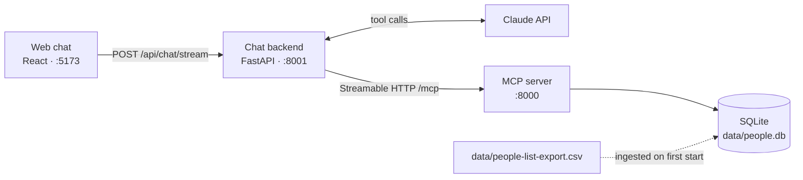

# People Search

Ask questions about a company's people records in plain English, for example *"How many people live in London?"* or *"What is the average age of employees?"*, and get answers backed by real data.

The project has two parts:

1. **An MCP server** that loads the people CSV into SQLite and exposes typed query tools over **Streamable HTTP at `/mcp`**.
2. **A chat interface**: a React web app plus a small Python backend. The backend lets Claude answer questions by calling the MCP server's tools.



## Quick start

**Prerequisites:** [uv](https://docs.astral.sh/uv/) (it installs Python for you), Node.js 20+, and an [Anthropic API key](https://platform.claude.com) (separate from a claude.ai subscription).

```bash
cp .env.example .env          # then put your key in ANTHROPIC_API_KEY
```

Run each service in its own terminal:

```bash
# 1. MCP server: builds data/people.db from the CSV on first start
cd server && uv run python server.py

# 2. Chat backend
cd chat && uv run --env-file ../.env uvicorn main:app --port 8001

# 3. Web UI
cd web && npm install && npm run dev
```

Open **http://localhost:5173**, then click an example question or type your own.

While Claude works, you see each lookup as it happens ("🔧 Looking up `count_people`…"), then the answer appears as it's written. Under each answer, **"Tools used"** shows exactly which MCP tools Claude called, with what arguments, and what the server returned.

## Example questions

| Question | What happens |
|---|---|
| How many people live in London? | `count_people` filtered by city |
| What is the average age of employees? | `aggregate` of age over active people |
| How many hourly employees work in London? | `count_people` filtered by city and salary type |
| Average salary by office | `aggregate` grouped by office, in each office's own currency |
| Average salary of everyone in USD | `aggregate` with live conversion to USD |
| Who reports to Bea? | `get_person`, which matches the nickname and returns direct reports |
| And in New York? | Follow-up questions work because the chat history is sent with each request |

## MCP tools

| Tool | Purpose |
|---|---|
| `get_dataset_overview` | Total count, valid values for each category field (cities, teams, …), and notes on the data |
| `count_people` | Count people matching a filter, optionally grouped by a field |
| `aggregate` | avg / min / max / sum / median of age, tenure or annual salary |
| `search_people` | List matching people, sorted, limited to 100 per call |
| `get_person` | One person's full record with their manager and direct reports |

All tools share one typed `filter` object (city, team, salary type, age range, manager, …). See [DESIGN.md](DESIGN.md) for the details.

To explore the server on its own, run `npx @modelcontextprotocol/inspector` and connect to `http://localhost:8000/mcp` (transport: Streamable HTTP).

## Project layout

```
data/      people-list-export.csv (source). people.db is generated, not committed
server/    MCP server: ingest.py (CSV → SQLite), fx.py (currency rates), server.py (tools)
chat/      Chat backend: main.py (Claude tool-use loop; streaming and JSON endpoints)
web/       React + Vite + TypeScript chat UI (src/App.tsx)
```

## Configuration

Set these in `.env`, which the chat backend reads:

| Variable | Default | Purpose |
|---|---|---|
| `ANTHROPIC_API_KEY` | (none) | Required. Your Claude API key |
| `MCP_URL` | `http://localhost:8000/mcp` | Where the chat backend finds the MCP server |
| `CLAUDE_MODEL` | `claude-haiku-5-5` | The Claude model to use |
| `CLAUDE_EFFORT` | `low` | How hard the model thinks: `low`, `medium` or `high`. Lower is faster |

## Data

The server loads the CSV into SQLite automatically the first time it starts.

To reload after changing the CSV:

```bash
cd server && uv run python ingest.py
```

## Tests

Run every test and check (none of these call a paid API):

```bash
cd server && uv run pytest && uv run ruff check . && uv run ruff format --check . && uv run mypy .
cd chat   && uv run pytest && uv run ruff check . && uv run ruff format --check . && uv run mypy .
cd web    && npm test && npm run lint && npm run build
```

| Suite | What it checks |
|---|---|
| `server/tests/test_ingest.py` | CSV parsing: day-first dates, nicknames, currency codes, salary annualizing, empty values, manager links |
| `server/tests/test_tools.py` | **Functional.** Every MCP tool called through a real MCP client: counts, filters, aggregates, currency handling, search limits, person lookup, error messages, SQL-injection safety |
| `server/tests/test_http.py` | **End-to-end.** Starts the real server process and calls it over Streamable HTTP at `/mcp` |
| `chat/tests/test_chat.py` | **Functional.** The real tool-use loop against the real MCP server, with a scripted fake Claude: tool results and errors flow back correctly, the 8-round cap, history, input validation, error messages |
| `chat/tests/test_e2e.py` | **End-to-end, opt-in.** Real Claude and the real MCP server answer the example questions; checks the key fact in each answer, and that prompt caching is actually hit |
| `web/src/App.test.tsx` | The chat UI: sending, answers, the "Tools used" panel, inline errors, follow-up history |

The expected numbers in the server tests are computed straight from the CSV with plain Python, independently of the server's code, so the tests check the whole path from CSV to SQLite to tool result.

The end-to-end Claude tests cost a few cents per run, so they're skipped unless you ask for them:

```bash
cd chat && RUN_E2E=1 uv run --env-file ../.env pytest -m e2e
```

## Code quality

Python code is fully type-annotated and checked with **ruff** (lint and format) and **mypy** in strict mode, tests included. The web app is checked with **oxlint** and the TypeScript compiler.
